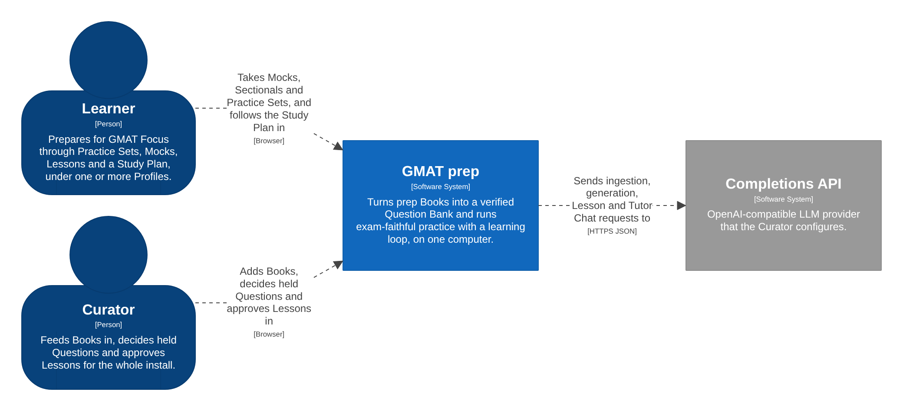
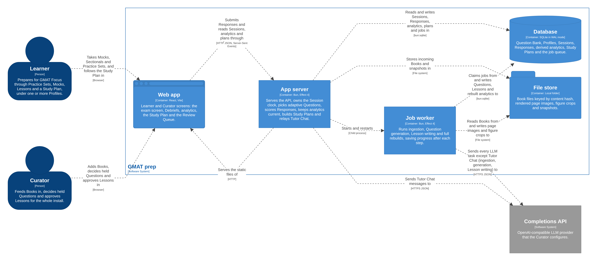
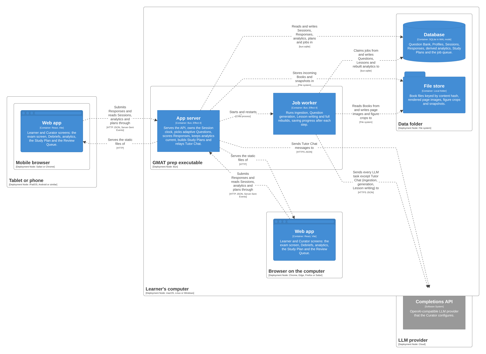

# GMAT prep design

Agreed in the design session of 15 and 16 October 2026. Terms follow GLOSSARY.md, decisions with a lasting cost have an ADR in docs/adr, and the C4 model is docs/workspace.dsl. Where this document sets a rule or starting value that the session did not discuss, it is listed under "Decisions added while writing this spec", and changes to agreed lines are listed under "Corrections to agreed lines".

## Problem statement

A Learner preparing for GMAT Focus owns prep Books full of good Questions, but paper cannot time a Section, adapt to the Learner's level, track every mistake or show which Skills cost the most points. Paper also cannot present Data Insights the way the exam does, with sortable tables, charts with dropdown blanks and tabbed sources. Online prep tools do these things only with their own content, and none of them can use the Learner's Books.

## Solution

One executable, installed and run on the Learner's own computer, that:

- reads the Curator's Books with an LLM and turns them into a verified Question Bank, holding back anything it cannot verify;
- writes new Data Insights Questions whose answer keys are computed by code from typed Datasets;
- runs Mocks, Sectionals and Practice Sets under exam rules, with a clock the browser cannot change;
- records every Response as a fact and derives Difficulty, Ability, Score Estimates and Weak Areas from those facts;
- logs every mistake with its cause, schedules Retries, builds a Study Plan, and teaches through Debriefs, Lessons and Tutor Chat;
- keeps working without the LLM, except for Tutor Chat.

Several Profiles share one install and one Question Bank.

## User stories

### Curator

1. As the Curator, I want to add a Book file and have the same file ignored if I add it again, so that the Question Bank never doubles up.
2. As the Curator, I want to mark a Book as official GMAC material, so that Weak Area priorities use official frequencies.
3. As the Curator, I want a cost projection from a 10-page sample before a Book's full run, so that I choose the spend knowingly.
4. As the Curator, I want to confirm the Book Map the app proposes, so that extraction reads the right page ranges for Questions, keys, explanations and difficulty labels.
5. As the Curator, I want each Book's report to count extracted, published, held, merged and skipped Questions, so that nothing vanishes silently.
6. As the Curator, I want Sentence Correction and geometry skipped and counted, so that the Question Bank holds only what GMAT Focus tests.
7. As the Curator, I want old Data Sufficiency and Integrated Reasoning content mapped into Data Insights, so that older Books still help.
8. As the Curator, I want an ingestion job to resume after a crash, a rate limit or a spend cap without paying again for finished pages, so that interruptions cost nothing.
9. As the Curator, I want a spend cap per job, so that a runaway job stops on its own.
10. As the Curator, I want every held Question to show why it was held, so that I can decide quickly.
11. As the Curator, I want to replace a Book's answer key with a stated reason, so that a known erratum stops teaching the wrong answer.
12. As the Curator, I want past Responses re-scored and the key-dependent teaching content rewritten after a key change, so that neither analytics nor Debriefs rest on a wrong key.
13. As the Curator, I want to fix a Book Map after the fact and re-run only the steps that depend on the keys, so that a misaligned answer key costs little LLM spend.
14. As the Curator, I want near matches put to me to judge as a Variant or a merge, so that changed numbers are never merged silently.
15. As the Curator, I want to generate Data Insights Questions in batches by Question Type, Skill and Difficulty, so that GI, TA, TPA and MSR practice does not depend on what my Books contain.
16. As the Curator, I want to approve generated statements that code cannot evaluate, so that nothing unverified is published.
17. As the Curator, I want to approve each Lesson before Learners see it, so that a person checks all teaching text.
18. As the Curator, I want to withdraw a Question without losing its history, so that a broken Question leaves practice while past results stay explainable.
19. As the Curator, I want to release Mock Reserve Questions into practice, so that I control the trade between practice volume and Mock freshness.
20. As the Curator, I want Question Bank coverage by Skill and Difficulty Band, and a list of Skills running out of Questions, so that I know which Books or generation batches to add.
21. As the Curator, I want Skills with fewer than 15 Questions flagged after ingestion, so that I can merge them into a related Skill.
22. As the Curator, I want Learners' Problem Reports in the Review Queue, so that suspected key errors reach me.
23. As the Curator, I want to set the API base URL, the key, a model per task and the price per model, so that I can use any OpenAI-compatible provider and see real spend.
24. As the Curator, I want a monthly Tutor Chat cap, so that chat spend stays bounded.
25. As the Curator, I want to see jobs, their progress and their spend, so that I know what the worker is doing.
26. As the Curator, I want to restore a snapshot, so that a bad change can be undone.
27. As the Curator, I want to export the whole install, so that I can move it to another computer.
28. As the Curator, I want to reset a Profile's PIN, so that a forgotten PIN does not lose a history.
29. As the Curator, I want to reset my passphrase with a command on the host computer, so that physical access is the final authority.
30. As the Curator, I want to turn on LAN mode, pair a tablet with a code shown on the host and revoke it later, so that only devices I approve can connect.

### Learner

31. As a Learner, I want to create one or more Profiles, each with an optional PIN, so that a retake cycle or a second person keeps a separate history.
32. As a Learner, I want to set a test date, target score, weekly hours and days off, so that the Study Plan fits my life.
33. As a Learner, I want to start with a Diagnostic, taken as one Mock or as three Sectionals over up to 3 days, so that the plan starts from evidence.
34. As a Learner, I want Mocks with Sections in my chosen order and the optional 10-minute break after the first or second Section, so that practice matches exam day.
35. As a Learner, I want Sectionals under the same rules, so that I can work on one Section at exam conditions.
36. As a Learner, I want Practice Sets chosen by Section, Question Type, Skill, Difficulty Band and status (unseen, missed, bookmarked), timed or untimed, so that I can aim my practice.
37. As a Learner, I want Practice Sets that follow a Book in order, such as one Book's Data Sufficiency 1 to 30, so that I can work alongside the printed book.
38. As a Learner, I want to mark a Book or a page range as studied on paper, so that Mocks avoid Questions I have already seen.
39. As a Learner, I want Mocks to adapt to my answers and to serve RC passages and MSR sets as a unit, so that they behave like the exam.
40. As a Learner, I want to Bookmark Questions and change up to three answers on the Review & Edit screen, so that I practise the exam's review rules.
41. As a Learner, I want the clock to keep running when I close the tab and the Session to resume exactly where I was, so that the Section is timed honestly.
42. As a Learner, I want time lost to a crash or a sleeping computer left uncounted, with the Session marked, so that an Interruption does not cost me the Section.
43. As a Learner, I want to take over a Session from another device after confirming, so that a stuck tab never blocks me.
44. As a Learner, I want the calculator only in Data Insights, so that I practise Quant without one.
45. As a Learner, I want to hide the timer, get a warning at 5 minutes, answer with the keyboard, and use dark mode and a larger font, so that the screen suits me.
46. As a Learner, I want to mark a Practice Set answer as guessed, so that a lucky guess still reaches my Error Log.
47. As a Learner, I want the Debrief after each Question in untimed Practice Sets and at the end of timed ones, so that I learn without breaking timing practice.
48. As a Learner, I want to pause Practice Sets, so that interruptions at home do not spoil them.
49. As a Learner, I want every Score Estimate shown with a range and marked uncalibrated until I enter an Official Score, so that I do not over-trust it.
50. As a Learner, I want to enter Official Scores, so that Score Estimates line up with GMAC's scale.
51. As a Learner, I want a Mock report with each Question's Difficulty, result and time, the effect of my Review & Edit changes, Interruptions and repeats, so that I can study the Mock afterwards.
52. As a Learner, I want a Debrief that explains why the option I picked tempted me, shows the verified Approaches fastest first and offers Siblings, so that each mistake teaches something.
53. As a Learner, I want wrong, slow and guessed Questions to enter my Error Log automatically, so that I never curate it by hand.
54. As a Learner, I want each wrong Part's Mistake Type filled in for me and changeable with one tap, so that tagging takes seconds.
55. As a Learner, I want missed Questions to come back on a Retry Ladder, first the same Question and then two Siblings, so that I prove I learned the Skill and not the answer.
56. As a Learner, I want Weak Areas ranked by the points they cost, each with a button that starts its remedy, so that I work on what matters most.
57. As a Learner, I want a Skill map shaded by each Skill's gap, grey where data is thin, so that I see the whole picture.
58. As a Learner, I want timing analysis by Question Type and a pacing curve for each Mock, so that I can fix time management.
59. As a Learner, I want Mistake Types and Trap Patterns tracked over time, so that I see whether careless errors are falling.
60. As a Learner, I want the Study Plan to rebuild itself each Study Day and after each Mock, and to list what it dropped when time runs short, so that the plan stays honest.
61. As a Learner, I want a Daily Log filled in automatically, with room for a note, so that I can see my consistency.
62. As a Learner, I want my Study Day to start at an hour I choose, 4 am by default, so that late sessions count for the right day.
63. As a Learner, I want a Lesson for every Skill and Question Type, with worked examples from real Questions and a 5-Question check, so that I can learn what I am weak at.
64. As a Learner, I want to ask Tutor Chat why my approach to a Question was wrong, so that I get an explanation of my own reasoning.
65. As a Learner, I want to report a Question I believe is wrong, so that the Curator checks it.
66. As a Learner, I want to use the app from a tablet on my home network, so that I can take a Mock away from my desk.
67. As a Learner, I want my Profile hidden from other Profiles on the same install, so that my results are private.
68. As a Learner, I want to export and delete my Profile, so that I own my data.
69. As a Learner, I want my Study Days to follow my time zone when I travel, so that the Daily Log stays correct.

## Implementation decisions

### The exam the app imitates

Checked against mba.com on 15 October 2026.

| Section | Questions | Time | Content |
|---|---|---|---|
| Quantitative Reasoning | 21 | 45 min | Problem Solving; no calculator; no geometry |
| Verbal Reasoning | 23 | 45 min | Critical Reasoning and Reading Comprehension |
| Data Insights | 20 | 45 min | DS, MSR, TA, GI, TPA; on-screen calculator |

- The exam lasts 2 hours 15 minutes for 64 Questions. Sections come in any order, with one optional 10-minute break after the first or second Section.
- A Question must be answered before the next appears. There is no skipping and no going back.
- Any Question can be Bookmarked. If time remains after the last Question, Review & Edit allows up to three changed answers. A Section that times out ends with no review.
- Section scores run from 60 to 90. The Total runs from 205 to 805 in steps of 10 and always ends in 5. The three Sections weigh equally, unanswered Questions lower the score, and GMAC does not publish its scoring formula.
- Multi-Part Data Insights Questions score all or nothing.

### System shape

| Container | Technology | Responsibility |
|---|---|---|
| Web app | React, Vite; static files | Learner and Curator screens |
| App server | Bun, Effect 4 | API, Session clock, adaptive selection, scoring, analytics, Study Plan, Tutor Chat |
| Job worker | Bun, Effect 4; separate process | Ingestion, generation, Lesson writing, full rebuilds; every LLM call except Tutor Chat |
| Database | SQLite in WAL mode | Everything except files; also the job queue |
| File store | Local folder | Books keyed by content hash, page images, figure crops, snapshots |

- `bun build --compile` makes one executable per OS. The app server starts the job worker from the same executable and restarts it if it dies (ADR 0001, ADR 0010). For development, `bun install && bun dev` runs from the repo.
- Data lives in the OS's app-data folder by default, and the location can be changed.
- The stack is Effect 4 (stable since 1 October 2026) with the Bun platform package, and Drizzle 1.0's Effect driver for Bun SQLite, pinned while it is a release candidate. Database access sits behind repository services, so the stable fallback, @effect/sql-sqlite-bun with hand-written SQL, can replace the driver without touching callers (ADR 0011).
- The API is HTTP JSON defined with Effect HttpApi and Schema. The web app calls it through a client derived from the same definitions. One Server-Sent Events stream per device, GET /api/events, pushes six events: clock sync, Section expired, Session claimed elsewhere, job progress, plan rebuilt and Review Queue changed. Job progress reaches the server through the database: each open stream reads changed jobs by revision twice a second. Each event's id is the revision it carries, so a page opens the stream after the job list it has read, and a browser that reconnects resumes from the last event it received. The stream's keep-alive checks the Curator unlock without counting as use, so an open page does not keep the Curator unlocked.
- Derived numbers update in small steps when a timed Practice Set ends, one Rated Response at a time, when a Sectional closes, and when a Mock ends, its Sections in the order taken. Full rebuilds, for example after a Key Override, run in the worker.
- The web app renders math with KaTeX, and both Question charts and analytics charts with Vega-Lite.

### Modules

Rules live in pure modules that take plain data and return plain data. Services wrap them with storage and time, which keeps the hard logic testable without a database.

| Module | Owns | Interface | Runs in |
|---|---|---|---|
| Taxonomy | Loading, validating and looking up the versioned Taxonomy | current version; whether a tag is valid for a Question Type | both |
| Question Bank | Questions, Parts, options, Stimuli, Datasets, Sources and Approaches; publishing, withdrawing, Key Overrides, dedupe | publish, withdraw, override a key, find candidates by filter | both |
| Ingestion | Book registry, cost preview, Book Map, extraction steps and their checkpoints | add a Book, preview cost, propose and confirm a Map, run a range | worker; adding a Book in the server |
| Publish Gate | Every check before publishing, and the Review Queue | check a draft and return pass, or held with reasons | worker |
| DI generator | Datasets, statements with predicates, computed keys, chart specs | generate a batch from a spec | worker |
| DI evaluator | Evaluating a predicate over a Dataset | evaluate a predicate against a Dataset | worker and tests |
| Renderer | Markdown with KaTeX, Vega-Lite to SVG, custom shapes such as Venn diagrams | render a Question, or fail with the reason | both |
| LLM adapter | Task routing, schema validation, retries, spend, the recorded-reply fake | call a task with input and an output schema | both |
| Session engine | Session lifecycle, Section clock, adaptive selection, Section Blueprint, Mock Reserve rules, Review & Edit, device claims, idempotent submits | start, claim, submit, Bookmark, edit, finish review, break, pause, resume | server |
| Ratings | Rated Response rules, Difficulty updates, Ability fits, Score Estimates, calibration | record a Rated Response, fit a Profile, score a Section, compute a Total, rebuild | server; rebuilds in worker |
| Learning | Error Log, Mistake Types, Retry Ladder, Sibling choice, Weak Areas | record a Response, set a Mistake Type, due Retries for a Study Day, Weak Areas | server |
| Planner | Study Plan rules and the Diagnostic | build a plan version from inputs, state and Study Day | server |
| Teaching | Debriefs, Lessons, Tutor Chat, Problem Reports | Debrief for a Response, Lesson for a subject, Tutor Chat message | server; Lesson writing in worker |
| Access | Profiles, PINs, the Curator passphrase, pairing, cookies, lockouts | create, unlock, pair, revoke, reset | server |
| Operations | Snapshots, restore, export, integrity checks, migrations, single-instance lock, worker supervision | snapshot, restore, export | server |

### Data model

Facts are written once and never edited. Derived tables can be dropped and rebuilt from facts and the current keys (ADR 0005). Plans are a third kind: append-only versions. Every row an LLM wrote records the model, prompt version and creation time.

Question Bank, written by the worker and by Curator decisions:

| Table | Holds |
|---|---|
| books | title, edition, file hash (unique), size, page count, pages with text, how scanned pages are read, official GMAC flag, status, cost preview, current job |
| book pages | Book, page number, text, whether it has a text layer, how it is read (text, image or Review Queue), what the Book Map model found on it |
| book map proposals | Book, page ranges, model, prompt version, time |
| book maps | Book, version, page ranges by role (questions, answer key, explanations, difficulty labels), each with its question set and Question Type group, confirmation time |
| page readings | Book, page, role, Question Type group, what the extraction model read there, model, prompt version, time |
| book skips | Book, question set, number, page, why it is not a Question (geometry or Sentence Correction) |
| stimuli | kind (passage, MSR tabs, table, chart, figure), Markdown body, Dataset, chart spec, figure crop, Reserve flag |
| datasets | typed columns (number, percent, currency, date, text), rows, whether a Book or the generator made it |
| questions | Section, Question Type, Stimulus, stem, status (draft, held, published, withdrawn), Difficulty seed and its basis (Book Label or LLM estimate), Book Label, primary and secondary Skills, Reserve flag, normalized-text hash, Taxonomy version |
| parts | Question, position, kind (single choice, yes/no, true/false, dropdown, column choice), prompt, key, key basis (Book, computed, override) |
| options | Part, position, text; for wrong options the Trap Note, Mistake Type and Trap Pattern |
| statement predicates | Part, predicate, independent second predicate, evaluated result (Generated Questions only) |
| approaches | Question, Strategy, steps, expected seconds, valid-when note, author (Book or LLM), position |
| sources | Question, with a Book, question set, page and number, the Book's key, explanation and label, and whether it joined a Question already in the Bank; or a generation batch |
| key overrides | Part, previous key, new key, reason, time |
| review items | Question, or a Book page extraction could not read; reasons, the related Question, status, decision, time |
| problem reports | Question, Profile, text, status |
| lessons | subject (Skill or Question Type), body, worked-example Questions, check Questions, status (draft or approved) |
| generation batches | spec, status, counts |

Profiles and activity, written by the server:

| Table | Holds |
|---|---|
| profiles | name, PIN hash, time zone, rollover hour, target score, test date, weekly hours, days off |
| paper marks | Profile, Book, page range, time |
| lesson views | Profile, Lesson, time; its worked examples become Seen |
| sessions | Profile, kind, configuration (Section order, filters, timed or not, size), status, holding device, interrupted flag |
| section runs | Session, Section, position, time limit, elapsed time, edits used, how it ended |
| served questions | Session or section run, position, Question, time served; what Sessions made Seen |
| responses | Profile, Session, Question, client sequence number, selection per Part, time spent, guessed flag, kind (first, edit, retry, time-out with no selection), the Response it supersedes, time |
| bookmarks | Session, Question |
| mistake labels | Profile, Response, Part, Mistake Type the Learner set, time (the app's own are worked out, not stored) |
| official scores | Profile, date, kind, Total and Section scores |
| tutor messages | Profile, Question, message, reply, model, prompt version, tokens, time |
| plan completions | Plan Item, the Session or Lesson that completed it, time |
| daily notes | Profile, Study Day, note |

Derived and rebuildable:

| Table | Holds |
|---|---|
| difficulty | Question, current Difficulty, count of Rated Responses |
| abilities | Profile, scope (Section, Skill or Question Type), value, uncertainty, evidence count |
| score estimates | Profile, Section or Total, time, value, range, calibrated flag |
| error log entries | worked out on read, not stored: Profile, Question, reasons (wrong, slow, guessed), status (open, Resolved, withdrawn) |
| retry steps | entry, step, due Study Day, Sibling, outcome |
| weak areas | Profile, Skill or Question Type, gap, Priority, slow flag, evidence count |
| daily logs | Profile, Study Day, minutes, Questions, accuracy by Section, Mocks, planned and completed items |
| analytics rollups | aggregates behind each analytics view |

Plans, append-only:

| Table | Holds |
|---|---|
| plan versions | Profile, version, build time, the Study Day it starts from, inputs |
| plan items | plan version, Study Day, kind, parameters, estimated minutes, status (planned, done, dropped), reason for dropping |

Operations:

| Table | Holds |
|---|---|
| jobs | kind, parameters, status, checkpoint, spend cap and spend so far, claimant, heartbeat |
| llm calls | job, task, model, prompt version, tokens in and out, estimated cost, outcome |
| devices | name, token hash, pairing time, revocation time |
| snapshots | file, kind, time, size, checksum |
| settings | non-secret settings |
| taxonomy versions | version, file hash, load time |

The API key never enters the database (see "LLM adapter").

### API

Every Profile operation needs an unlocked Profile on the host or a paired device, and Curator operations need the Curator passphrase. Errors are tagged and map to HTTP statuses.

| Area | Operations |
|---|---|
| Access | create, unlock, lock, update or delete a Profile; export a Profile; unlock as Curator; reset a PIN; make a pairing code; pair, list or revoke devices |
| Sessions | start; get state, including the server's remaining time; claim from another device; submit a Response; set a Bookmark; take or skip the break; pause and resume a Practice Set; change an answer in Review & Edit; finish review; get the report |
| Learning | get a Debrief; set a Mistake Type; get the Error Log; get due Retries; get Weak Areas; get an analytics view; get the Study Plan; get the Daily Log; write a Daily Log note; add an Official Score; add or remove a Paper Mark; file a Problem Report; open a Lesson; send a Tutor Chat message |
| Curator | add a Book; list or get Books; read a Book again; start the full run after the cost preview; confirm a Book Map; open a Book's PDF; list, pause, resume or cancel jobs; get the Review Queue; decide a review item; override a key; withdraw a Question; release Reserve Questions; start a generation batch; approve a Lesson; get coverage; read and change settings; take or restore a snapshot; export the install |
| Events | clock sync, Section expired, Session claimed elsewhere, job progress, plan rebuilt, Review Queue changed |

### Content pipeline

Books with a text layer come first, starting with the Official Guide family. A page with fewer than 20 characters of text is a scanned page. Scanned pages take the image path when the extraction model is marked in Settings as reading images; otherwise figure Questions and scanned pages go to the Review Queue. The route is decided when the full run starts, from the model set then.

Ingestion runs these steps. Each step saves its progress, so a job resumes from the last finished step after a crash, a rate limit or its spend cap.

1. Register. The PDF streams to the books folder while it is hashed; its SHA-256 is its fingerprint, and a known fingerprint does nothing. The file is stored once under its hash, with the official flag the Curator set. The worker then reads every page's text, a hundred pages a step, and records which pages carry a text layer.
2. Preview cost. The pipeline runs on a 10-page sample spread through the Book: the Book Map model surveys the 10 pages, and the extraction model reads those it can extract. The preview projects each step's tokens and cost for the full run from what the sample's calls took. Its Questions are counted a question set at a time, as the survey gives them, every one of them, a passage's later questions and a set's repeated numbers included; only those whose passage the sample has are enriched to cost enrichment. The full run waits for the Curator, who starts it with a spend cap that all the run's jobs share, across restarts. The sample's extraction readings are kept for the full run; its surveys are not, since a page surveyed among its neighbours gets its chapter right more often.
3. Map. The Book Map model reads every page with text, in order and ten at a time, and says what each holds: its role, its Question Type group and its chapter. Code joins neighbouring pages into ranges. Chapters compare by number and title, so "Chapter 3" and "Chapter 4" stay apart. Answer keys, explanations and difficulty labels join the questions of their chapter and group, or else the nearest earlier questions of their group, or else the next ones. Questions with no chapter are named after their group, with their first page when another set has that name. The Curator can also map a Book by hand before the full run, which skips the survey. The Curator corrects the proposal on one screen, opening pages in the browser's PDF viewer to check, and confirms it. Each confirmation is a new Book Map version.
4. Extract. Confirming a Book Map starts extraction. The extraction model reads each page of a range in the range's role: the questions that start on the page, finishing one that runs on from the next page; the answers on a key page; the explanations that start on the page; or its difficulty labels. Each reading is stored by page, role and Question Type group, so a page is read once however often the Book Map changes. Each range yields Questions, Parts, options, Stimuli and figure crops, and tables and charts become Datasets where possible. Question text is Markdown with LaTeX between `\(` and `\)` or `\[` and `\]`, so a dollar sign stays a price. Retired items, geometry and Sentence Correction, are skipped and counted. Old DS becomes Data Insights, and old Integrated Reasoning maps onto MSR, TA, GI and TPA (ADR 0004). Pages with no text layer in a mapped range wait in the Review Queue until the image path exists.
5. Link. Each Question is linked by its question set and number to its key, its explanation and its difficulty label. The key comes from the answer key, else from the explanation; when both give one and they differ, the Question is held.
6. Enrich. The LLM tags the Question Type and Skills from the Taxonomy, estimates Difficulty and writes one or two Approaches with their Strategies; a Book's own explanation becomes one Approach. For each wrong option it writes a Trap Note, the Mistake Type the option most likely signals and, where one fits, a Trap Pattern. Option tags never use Time pressure, which comes only from timing.
7. Dedupe. Questions with identical normalized text (question and choices, ignoring case, spacing, math delimiters and a few equivalent LaTeX spellings) and the same key merge into one Question with several Sources, unless the text or a figure is in doubt; a keyless Question takes the key of the same Question from another Book and waits for the Curator. Every Source's key must agree with the Question's. Identical text with different keys, and near matches, go to the Review Queue with the other Question beside them, because a copy with changed numbers is a Variant. A near match is text whose three-character pieces, with every number masked, are at least 85% shared. The Curator keeps a near match as a Variant or merges it into the other Question.
8. Publish Gate.

A Question publishes only when every check passes. Otherwise it is held with every failing reason.

| Check | Held when |
|---|---|
| Structure | a Part lacks options or a single key, a referenced Stimulus is missing, or a Dataset column has the wrong type |
| Key | an Extracted Question has no Book key |
| Solver agreement | any of three independent LLM solves disagrees with the Book key; the key is never changed automatically |
| Approaches | an Approach still misses the key after one regeneration |
| Tags | a tag is outside the Taxonomy or not allowed for the Question Type |
| Difficulty | the Book Label and the LLM estimate are two bands apart |
| Figures | a figure could not become data and is still an image |
| Rendering | KaTeX or Vega-Lite fails to render on the server |
| Near match | the Question nearly matches another (a possible Variant), or matches one with a different key |
| Generated keys | a statement's two predicates disagree, or a statement code cannot evaluate lacks solver agreement and Curator approval |

A key change, from a Key Override or a fixed Book Map, holds the Question while its key-dependent content (its Approaches and, for each wrong option, the Trap Note, Mistake Type and Trap Pattern) is regenerated, then sends it back through the Publish Gate. Tags, Difficulty estimates and solver runs are reused. Every past Response is re-scored, and affected Mock scores are marked "rescored". A Key Override also stores its reason.

Generated Questions (ADR 0003):

- The Curator starts a batch by Question Type, Skill, Difficulty and count. v1 generates only GI, TA, TPA and MSR with data tabs. Quant, Verbal and DS Questions come from Books.
- The LLM writes a typed Dataset and the statements. Each statement carries a predicate in a small query language (filter, sort, rank, count, sum, average, ratio, percent change, compare), and the DI evaluator runs it to get the key.
- A second, independent LLM pass translates each statement's text into a predicate. Both predicates must give the same result on the Dataset, which catches text that says something different from its predicate.
- A GI dropdown must have exactly one option that fits the computed value. For "approximately", the nearest option counts, and options must sit far enough apart that rounding cannot change the answer. A TPA must have exactly one pair that meets every condition.
- MSR statements that are inferences from text, which code cannot evaluate, need three agreeing solver runs and Curator approval.
- The chart is a Vega-Lite spec bound to the same Dataset (ADR 0006).
- Generated Questions then go through Enrich and the Publish Gate like Extracted ones, and each batch gives a quarter of its Questions to the Mock Reserve.

Lessons cover each Skill and each Question Type, 73 subjects in Taxonomy v1 (52 Skills and 21 Question Types). Each Lesson holds the rules, the methods with when each is valid, common traps, worked examples, and a 5-Question check that runs as an untimed Practice Set. Worked examples and check Questions are published Questions from outside the Mock Reserve, and opening a Lesson makes its worked examples Seen for that Profile. The worker writes Lessons after ingestion and the Curator approves each one. A Taxonomy change marks affected Lessons for rewriting.

The Taxonomy file, taxonomy/v1.yaml, holds 3 Sections, 13 Topics, 52 Skills, 21 Question Types, 6 Mistake Types, 38 Trap Patterns and 21 Strategies. Skills are shared across Sections (ADR 0007). Taxonomy changes ship as migrations that re-tag the affected Questions. After ingestion, any Skill with fewer than 15 Questions is flagged for merging.

### Sessions

| Kind | Rules |
|---|---|
| Mock | All three Sections in the Learner's order, 45 minutes each, adaptive, optional 10-minute break after Section 1 or 2, Review & Edit, calculator in Data Insights only |
| Sectional | One Section under Mock rules |
| Practice Set | Chosen by Section, Question Type, Skill, Difficulty Band, status (unseen, missed, bookmarked) or Source in book order. A timed set gets the sum of its Target Times and shows Debriefs at the end; an untimed set shows the Debrief after each Question. It can pause and has the guessed button |

The Section Blueprint sets how many Questions each group of Question Types gets. GMAC does not publish the mix, so these defaults are editable.

| Section | Groups |
|---|---|
| Quantitative Reasoning | PS: 21 |
| Verbal Reasoning | RC Question Types: 13, in 4 passages of 3, 3, 3 and 4 Questions; CR Question Types: 10 |
| Data Insights | DS: 7; MSR: 3, as one set; TA: 3; GI: 4; TPA: 3 |

The RC count follows prep-company estimates of 13 to 14, and the DS count follows the common estimate of about a third of the Section. The split among MSR, TA, GI and TPA is an even split with no published source.

Adaptive selection in Mocks and Sectionals:

- Each Section's estimate starts at Medium (0) and is refitted from that Section's Responses after each one (see "Ratings and scores").
- A candidate is a published Question, or an RC passage or MSR set taken as a unit, whose group still has room. A unit's size must match one of its group's open slots (RC passages of 3 or 4 Questions and MSR sets of 3, by default), and outside the last tier below, none of its Questions may be Seen. When no unit fits, the remaining slots pass to the Section's other groups.
- Candidates are tried in this order: unseen Reserve candidates within 0.5 of the estimate; unseen candidates from anywhere within 0.5; unseen candidates at any distance, Reserve first; then the candidate Seen longest ago (for a unit, the one whose Questions were Seen longest ago), with Paper Marks counting as Seen from the day they were made. Within a tier, the pick is random among the five closest to the estimate. The report counts repeats.
- A unit's Questions are served one after another.

The Mock Reserve (ADR 0008) is a quarter of each Section's Questions, chosen per Stimulus, stratified by Question Type and Difficulty Band, and assigned deterministically as each Book or generation batch publishes. Practice Sets cannot use a Reserve Question until the Curator releases it or the Profile has Seen it. Release is one-way. Only units that fit a Blueprint slot can join the Mock Reserve, so oversized passages and sets serve Practice Sets only. A Mock can start only when the Mock Reserve holds, unseen by the Profile, at least twice the Blueprint count for every group of every Section, counting the three Difficulty Bands together; a Sectional checks only its own Section. This start check runs each time, and the screen says what is missing.

A Paper Mark makes a Book's Questions, or a page range of them, Seen for that Profile. Keeping at least one Book unread on paper leaves Mocks unseen Quant and Verbal Questions, since generation covers only Data Insights.

The clock (ADR 0009) ticks every second on the server and saves elapsed time every 5 seconds. A gap of more than 5 seconds between ticks means the process stopped or the machine slept; it is not counted and the Session is marked interrupted. The browser shows the time the server sends and resyncs on every Response and every 15 seconds. When time runs out with no browser connected, the server still ends the Section. In a Mock only the 10-minute break pauses the clock, and when the break runs out the next Section starts. Practice Sets can pause.

Every submit carries a per-Session sequence number, so a retry or double click is recorded once. One device holds a Session at a time. Opening it elsewhere asks whether to take over, and the old device turns read-only.

In Review & Edit, each change is a new Response that supersedes the earlier one in that Session, and both stay on record. The final answer is scored and becomes the Rated Response, and the report shows whether the changes gained or lost points. Because answers can still change, a Sectional updates Difficulty and Ability only when it closes, and a Mock only when it ends, its Sections in the order taken, since an estimate that moved at each Section's close would show how that Section went while the Mock runs. Timed Practice Sets update when the set ends, since a Score Estimate that moved after each answer would give away whether it was right.

When time runs out with a Question on screen, that Question gets a time-out Response with no selection. It counts as wrong, enters the Error Log with Time pressure and counts against the Mock Section score, but it is never a Rated Response.

### Ratings and scores

The model is logistic: a Profile with Ability θ gets a Question of Difficulty b right with probability 1 / (1 + e^-(θ - b)).

| Item | Rule |
|---|---|
| Difficulty seed | Book Label Easy -1, Medium 0, Hard +1; the LLM estimate on the same scale when the Book gives no label |
| Difficulty Band | Easy below -0.5, Hard above +0.5, Medium between |
| Rated Response | the final Response in the Session where the Question was first Seen, if that Session was timed and the Response is not a time-out. A Question first Seen through a Paper Mark or a Lesson is never Rated |
| Difficulty update | after each Rated Response, b moves by K × (expected - actual), with K = 0.3 / sqrt(1 + n) for a Question with n earlier Rated Responses |
| Section Ability | fitted per Profile by maximum a posteriori over the Section's Rated Responses, each weighted by recency with a 30-Study-Day half-life, under a normal prior with mean 0 and spread 1 |
| Skill and Question Type Ability | the same fit over Rated Responses carrying that Skill or Question Type, each also weighted 1 when the Skill is the Question's primary Skill and 0.5 when secondary. The prior has spread 1 and centres on the reference Ability |
| Reference Ability | the Section Ability, or for a Skill seen in several Sections, the Section Abilities averaged by where its Rated Responses came from |
| Ability uncertainty | the standard error from the same fit |
| Section score | uncalibrated: 75 + 5θ, rounded and kept within 60 to 90. One Official Score shifts the line to match it; two or more fit slope and offset by least squares, the slope kept within 2.5 to 10 (decision 56) |
| Section range | the scores of θ minus and plus 1.96 standard errors |
| Mock Section score | fitted from that Section's final Responses with prior mean 0 and spread 1. A time-out Response counts as wrong at its own Difficulty, and each unreached slot counts as wrong at the Difficulty of the last Question served |
| Total | 205 + (Q + V + DI - 180) × 20/3, rounded to the nearest value ending in 5 |
| Total range | plus or minus 1.96 × 20/3 × the square root of the sum over Sections of (slope × standard error) squared, where slope is the Section score's points per unit of θ (5 before calibration); rounded outward to values ending in 5 and kept within 205 to 805 |

The Total formula is not official. It reproduces the published third-party examples checked (81, 84 and 82 give 655; 84, 87 and 81 give 685) and both ends of the scale (all 60s give 205, all 90s give 805). The rounding never ties, since a tie would need (Q + V + DI - 180) × 4 to be odd.

### Learning loop

A Question enters the Error Log as one entry, holding every Response to it, when the final Response in a Session is:

- wrong: any Part wrong, including a time-out Response;
- slow: right, but over 1.5 × its Target Time, with RC passages and MSR sets timed as a whole;
- guessed: right, but marked guessed (Practice Sets only).

Target Time defaults to Section pace, 2:09 per Question in Quant, 1:57 in Verbal and 2:15 in Data Insights, and can be changed per Question Type.

Each wrong Part gets a Mistake Type, filled in by the app and changeable with one tap. The Mistake Type decides the remedy.

| Mistake Type | Meaning | What the Study Plan adds |
|---|---|---|
| Concept gap | Didn't know the rule or method | The Skill's Lesson, then practice |
| Wrong approach | Knew the content but used a slow or invalid method | The methods part of the Lesson, then timed practice |
| Trap | Chose the option written to tempt | Practice on Questions with the same Trap Pattern |
| Calculation slip | Right method, wrong arithmetic | Timed practice on that Skill |
| Misread | Misread the question, a statement or the data | Nothing extra; the trend is tracked |
| Time pressure | Rushed, or ran out of time | Timed practice at exam pace |

The app fills in the chosen wrong option's stored Mistake Type, unless timing points to Time pressure: the answer came in the Section's last 10% of time, took under a quarter of the Target Time, or was cut off by the clock. The timing rules read the Question's first Response in the Session, so a quick late edit in Review & Edit does not count as rushing. Slow and guessed entries carry "slow" or "guessed" instead.

A Weak Area is a Skill or Question Type whose Ability sits below its reference Ability. Its gap is the reference Ability minus its Ability. Priority is the gap times exam frequency, where frequency is the share of Questions from Books marked official that carry the Skill (primary Skill 1, secondary 0.5), falling back to the whole Question Bank until an official Book is loaded. A Skill is flagged slow when, on its correct Rated Responses, the median of time spent divided by each Question's own Target Time is over 1.3. Under 8 Rated Responses it shows "not enough data". Only Rated Responses count, so untimed practice never moves Weak Areas.

The Retry Ladder clears each Error Log entry in three steps, counted in Study Days after the miss:

| Step | When | What |
|---|---|---|
| 1 | Day 2 | The same Question with its Approaches hidden; untimed, or timed for a slow entry |
| 2 | Day 7 | An unseen Sibling, timed |
| 3 | Day 21 | Another unseen Sibling, timed |

- A step passes when the answer is right. For a slow entry it must also come within 1.5 × the Target Time, and for a guessed entry it must not be marked guessed.
- A miss repeats the step 2 Study Days later, with a new Sibling for steps 2 and 3, and the missed Sibling gets its own entry.
- Passing step 3 marks the entry Resolved, and it stays in the history.
- A Sibling is unseen, outside the Mock Reserve, within 0.5 of the missed Question's Difficulty, and shares its primary Skill and Question Type. Failing that, the step keeps those three conditions but matches the Question Type and a shared secondary Skill other than the DS sufficiency Skills; failing that, it is skipped with a note. The Curator sees which Skills are running dry.
- Due Retries take at most a fifth of a Study Day's planned time, ordered by the Priority of the Weak Area of their primary Skill; Retries whose Skill is not a Weak Area come last.
- A Withdrawn Question closes its entries as withdrawn.

The Debrief shows the Trap Note for each wrong option picked, the Approaches with the fastest valid one first (each with its Strategy, expected time and when it is valid), the Mistake Type control, and buttons for 3 Siblings, the Lesson, Tutor Chat and Report a problem. It makes no LLM call.

Tutor Chat sends the Question, its key, its Approaches and the Profile's mistake history for that Skill. The system prompt says the key is correct and that a Learner who believes otherwise should file a Problem Report. An identical message from the same Profile about the same Question reuses that Profile's stored reply. When the API is down or the monthly cap is reached, the chat says so and everything else keeps working.

### Study Plan, Diagnostic and Daily Log

Code builds the Study Plan by fixed rules, with no LLM, from the test date, target score, weekly hours, days off and the Weak Area ranking.

- Phases: the Diagnostic; Lessons and practice on the top Weak Areas; mixed practice; then one Mock a week over the last 4 weeks (fewer when the test is closer), with the last Mock at least 3 days before the test.
- A Mock day gets the minutes the Mock needs, and the week's other study days share the rest of the weekly hours. If the weekly hours are shorter than a Mock, the plan schedules Sectionals instead and says why.
- Each Study Day gets Plan Items that fit its minutes: Lessons, Practice Sets, due Retries and Mocks. A Practice Set is estimated at its Target Times plus 20% for Debriefs, a Lesson at 200 words a minute plus its 5-Question check, and a Mock at 2 hours 25 minutes including the break.
- Practice is pitched where the Profile gets about two in three right, at a Difficulty near θ - 0.69, since 1 / (1 + e^-0.69) is about 2/3.
- Remedies follow the Mistake Types in the table above.
- Plan Items are ordered by the Priority of the Weak Area they target; items that target no Weak Area come last.
- Each rebuild, at the Study Day rollover and after each Mock, writes a new plan version from the current Study Day on. Earlier days, done items and dropped items keep their history. Missed work is never piled onto later days: when time runs short, the lowest items drop and the plan lists them.
- The plan schedules only as many Mocks as the start check will allow, counting one Blueprint's worth of unseen Reserve Questions per Mock. Without a test date the plan covers 2 weeks at a time.
- The target score sets the Section targets that progress is measured against.

The Diagnostic is a full Mock, or the three Sectionals spread over up to 3 days, and counts as the plan's first Mock. If the Learner skips it, or Mocks cannot start yet, every Section starts at Medium and the plan rebuilds once each Section has 20 Rated Responses; the Diagnostic is offered again once a Mock can start.

The Daily Log records, per Study Day, active minutes, Questions answered, accuracy by Section, Mocks, planned and completed Plan Items, and the Learner's note. The rollover hour is set per Profile, 4 am by default. A time zone change takes effect at the next rollover, and a 23- or 25-hour Study Day still gets one Daily Log.

### Analytics

| View | Shows |
|---|---|
| Score trend | Total and Section Score Estimates over time with ranges, plus Official Scores and the target |
| Weak Areas | Ranked by Priority, with gap, evidence count, slow flag, Mistake Type mix and a button that starts the remedy |
| Skill map | The Taxonomy tree shaded by gap, grey where there isn't enough data |
| Timing | Time against Target Time by Question Type, each Mock's pacing curve, accuracy on a Section's last 5 Questions compared with the rest, and slowness on Questions whose fastest Approach uses a given Strategy |
| Mistakes | Mistake Types and Trap Patterns per 100 Questions over time |
| Mock report | Per Section: Score Estimate, each Question's Difficulty, result and time, the effect of Review & Edit, Interruptions and repeats |
| Error Log | Filterable by Section, Skill, Question Type, Mistake Type, Trap Pattern, Difficulty Band, Book, status and date |
| Study | Daily Log calendar, and planned work against work done |

The Curator view shows Question Bank coverage by Skill and Difficulty Band, the Review Queue, jobs and spend, Mock Reserve remaining per Section, Skills running out of Questions, and Problem Reports. Profiles cannot see each other's data.

### Exam screen

- Layout: the Stimulus on the left and the Question on the right, stacked on narrow screens, with the question count and timer at the top.
- Exam rules: answer before moving on, no going back, Bookmark any Question, calculator only in Data Insights, Review & Edit at the end.
- Additions: a timer that can be hidden, a warning at 5 minutes left, keyboard shortcuts (A to E select, Enter submits), dark mode and adjustable font size.
- Practice Set extras that never appear in Mocks: the guessed button, the instant Debrief in untimed sets, and pause.
- The calculator offers addition, subtraction, multiplication, division, square root, percent and memory.

### Profiles, access and LAN mode

- A Profile can have a PIN. PINs and the Curator passphrase are stored as argon2id hashes. An unlocked Profile and an unlocked Curator are held in HttpOnly, SameSite=Strict cookies. An unlock ends after 12 hours without use, and a browser holds one at a time: unlocking another Profile ends the one before.
- Tabs share the browser's unlock, so each request names the Profile its tab shows, and the server refuses it when another tab has opened a different Profile. The tab then shows the Profile now unlocked.
- Five wrong PINs lock the Profile for 5 minutes. PIN checks run one at a time, so wrong PINs sent together still count one by one.
- The Curator passphrase is set the first time the Curator tools open. It has 8 to 200 characters, and five wrong entries lock the tools for 5 minutes, as with PINs.
- The Curator resets PINs, and the passphrase is reset by a command run on the host computer: `gmat-prep reset-passphrase`, which also ends every Curator unlock.
- Deleting a Profile needs its PIN or the Curator passphrase, and a snapshot is taken first.
- The server accepts connections from the host only, and answers only requests whose Host header names this computer (127.0.0.1, localhost or [::1]), which stops a web page from reaching it through DNS rebinding. Every response forbids framing and type sniffing. Writes are accepted only from the app's own pages (by Origin) and only as JSON of at most 1 MB, except adding a Book, whose body is the PDF itself, of at most 500 MB. In LAN mode it listens on the local network, and a new device must enter a 6-digit pairing code shown on the host; codes are single-use and expire after 5 minutes, and paired devices can be revoked. LAN traffic is plain HTTP, so LAN mode is for trusted networks.
- Profiles cannot see each other's data.

### LLM adapter

- Curator settings cover the base URL, a model per task and the price per model, all stored in the database, and the API key, stored only in a config file that the OS user alone can read, outside the data folder, so it never reaches snapshots or exports. The file is credentials.json in the config folder: ~/.config/gmat-prep on Linux, ~/Library/Preferences/gmat-prep on macOS and %LOCALAPPDATA%\gmat-prep on Windows, unless GMAT_PREP_CONFIG_DIR names another. The app refuses to start when that folder is inside the data folder.
- The adapter speaks the OpenAI-compatible chat completions API. It asks for JSON with structured outputs, JSON mode or instructions alone, as the Curator chooses, since providers differ in what they accept.
- The tasks are Book Map, extraction, solving, tagging, Approaches, generation, statement translation (the second predicate), Lessons and Tutor Chat.
- Every reply must match its JSON schema. The schema sent with a request is the strict form that structured outputs accept: an object at the root, every property required, null for a missing value, and few keywords; lengths, ranges and the like are checked when the reply is decoded. An invalid reply is retried once with the error attached, unless the first reply used up the job's cap. If it fails again, a Question-level step sends the Question to the Review Queue; any other job step fails and shows the error, and Tutor Chat shows an error to the Learner.
- 429, 5xx and lost connections are retried up to six times, with backoff that doubles from 1 second to at most 30, jitter of half either way, and at least the Retry-After the API gives. When the attempts run out, or Retry-After asks for more than a minute, the job pauses and resumes on its own after 5 minutes or that Retry-After, whichever is longer. Other refusals, such as a wrong key, and requests that could not be sent at all fail the step at once. A provider's error text is stored with any copy of the API key removed.
- A worker claims a job in one statement, so two workers never share one, and renews a heartbeat every 5 seconds; a job whose heartbeat is 30 seconds old is claimed again. Pausing a running job waits for its current step to be saved; cancelling stops the step at once. A pause or cancel asked while a step runs holds even when the step then fails or the API goes down.
- Every stored output records its model, prompt version and date, so a better model can re-run only what it would change.
- Spend is tokens times the per-model prices the Curator enters, since the API reports tokens but not cost. A reply without usage figures is priced from an estimate of four characters per token and marked as estimated. Spend counts against each job's cap and the monthly Tutor Chat cap; no call starts once a job's cap is reached, so the job pauses at its last saved step.
- Book text goes to the model as quoted data. Schema checks and key verification stop instruction-like text in a Book from changing a key.
- Math renders with KaTeX without commands that reach outside the page, such as links, and with its sizes capped; a Question that uses such a command is held. The web app renders math into the DOM and sets KaTeX's few style attributes again through the DOM, so the content security policy can refuse style attributes.

### Data safety and operations

- SQLite runs in WAL mode. Startup runs a quick integrity check and a full check runs weekly.
- `VACUUM INTO` takes consistent snapshots while the app runs: daily, keeping 7 daily and 4 weekly, and before every migration, Taxonomy change, bulk re-score, Profile deletion and restore.
- Book files are stored once, keyed by content hash. Snapshots skip page images, which can be rebuilt from the Books.
- Restore runs from the Curator screen, and the replaced database is kept as a snapshot too.
- Export covers one Profile (JSON) or the whole install (database plus Books).
- When the disk is full, ingestion pauses with a message and Sessions keep working. A failed snapshot is reported, never skipped silently.
- Migrations run at startup after a snapshot, each in its own transaction with foreign keys off, and each is rolled back if it leaves a broken reference. An app older than its database refuses to start rather than damage it.
- A lock stops a second copy from opening the same data folder. It is a file lock the operating system releases when the process ends, so a crash never leaves the folder locked. If the port is taken, the app uses the next free one and says which.
- Everything the app writes in the data folder is readable by the user who runs it and no one else.

### Speed targets

Measured on the install machine; each target must hold 95% of the time.

| Action | Target |
|---|---|
| Submit a Response until the next Question is on screen | under 100 ms |
| Start a Section | under 300 ms |
| Open an analytics view with 50,000 Responses | under 300 ms |
| Start the app | under 2 s |

Ingestion has no speed target, because the API's rate limits set its pace. It shows progress and an estimated finish time and never slows a Learner.

### Edge cases

| Scenario | Behavior |
|---|---|
| Tab closed during a timed Section | The clock keeps running. Reopening restores the exact state; if time ran out meanwhile, the Section has ended and unanswered slots count against the score |
| App stops or the machine sleeps during a Section | The gap is not counted, and the Session is marked interrupted |
| The break runs past 10 minutes | The next Section starts when the break ends |
| A Session opened on a second device | The second device asks to take over, and the first turns read-only |
| Double click or network retry on submit | The sequence number records the Response once |
| The clock runs out with a Question on screen | A time-out Response marks it wrong with Time pressure; it is never Rated |
| Curator withdraws a Question that is in Error Logs, plans or a running Session | A running Session keeps it. Afterwards its Responses stay in history but leave Ability, its Error Log entries close as withdrawn, and plans rebuild |
| Key Override while a Session is running | The Session is scored with the new key when it ends, past Responses are re-scored, and the Question is held until its key-dependent content is regenerated |
| Too few Questions on a fresh install | Mocks and Sectionals cannot start until the Mock Reserve passes the start check, and the screen lists what is missing |
| Diagnostic before a Mock can start | The plan starts every Section at Medium and offers the Diagnostic once a Mock can start |
| Same Book file added twice | Nothing happens |
| A rescan of a Book already ingested | It becomes a new Book. Identical Questions with the same key merge as extra Sources; near matches and conflicting keys go to the Review Queue |
| The Book Map was wrong, for example keys offset by one | Solver disagreements in the Publish Gate reveal it. After the Map is fixed, linking, the key-dependent content and the checks re-run; tags, Difficulty estimates and solver runs are reused |
| A formula or chart fails to render | The Publish Gate holds it, so Learners never see it |
| The Learner studied a Book on paper | A Paper Mark makes its Questions Seen for that Profile; Mocks use them only after unseen ones run out, and the report counts them |
| A Practice Set follows a Book in order | Unseen Reserve Questions in the range are skipped and shown as held for Mocks |
| No unseen Sibling left | The step falls back to a shared secondary Skill, then is skipped with a note |
| A Profile travels, or DST changes | Study Days follow the Profile's current time zone from the next rollover |
| App upgrade while a timed Section runs | The upgrade waits until the Section ends; a forced upgrade counts as an Interruption |
| Forgotten PIN or Curator passphrase | The Curator resets the PIN; the passphrase is reset by a command on the host computer |
| Repeated wrong PINs | After 5 misses the Profile locks for 5 minutes |
| Deleting a Profile | Needs its PIN or the Curator passphrase, and a snapshot is taken first |
| API down or rate limited | Jobs back off, pause and resume on their own; Tutor Chat says it is unavailable; everything else works |
| A job reaches its spend cap | It pauses at its last saved step |
| An LLM reply fails its schema twice | A Question-level step holds the Question in the Review Queue; any other step fails with the error |
| Disk full | Ingestion pauses with a message, Sessions keep working, and a failed snapshot is reported |
| A database written by a newer app version | The older app refuses to start |

### Defaults

| Topic | Default |
|---|---|
| Score conversion before calibration | Linear in Section Ability: Easy (-1) = 70, Medium (0) = 75, Hard (+1) = 80, kept within 60 to 90 |
| Ingestion cost | A 10-page sample projects tokens and cost before a full run, which starts only after the Curator confirms |
| Calculator | Basic arithmetic, square root, percent and memory |
| Language | English only |

### Build order

Tickets follow this agreed order: data model and Taxonomy, ingesting one Book, Practice Sets, Mocks, Error Log and Retry Ladder, Study Plan, then Lessons and Tutor Chat.

## Testing decisions

A good test drives the system through a seam and checks what a Learner or Curator would observe, never internal tables. The seams, highest first:

1. The HTTP API, with a fake clock and the recorded-reply LLM adapter. Most behavior is tested here: Sessions, scoring, the Error Log, Retries and plans.
2. The pure rule modules (Ratings, the Planner, the Retry Ladder, the DI evaluator), written test-first. Property tests check, for example, that every computed DI key matches a brute-force evaluation over its Dataset, that every Total stays within 205 to 805 and ends in 5, and that a plan never schedules more minutes than a Study Day has.
3. Ingestion against the golden set, the first 100 Questions the Curator approves from the first Book. Every prompt or model change must keep text, Parts and keys exact on all of them, and tags must match the Curator's labels at least 90% of the time.
4. One Playwright run of a full Mock on a fake clock, including an Interruption and Review & Edit.

The speed targets run as automated performance tests on a seeded database with 50,000 Responses. All tests run offline and cost nothing, using recorded LLM replies. There is no prior art yet; this is a new codebase.

## Out of scope

- Study reminders, EPUB Books, sync between installs, and native mobile apps; tablets and phones use the browser.
- Generating Quant, Verbal or DS Questions.
- GMAT Classic and other exams (ADR 0004).
- Hosting the app for other people.
- Languages other than English.

## Further notes

### Corrections to agreed lines

Each of these changes something the session agreed, to fix a problem that writing the full spec exposed. The owner approved all five on 16 October 2026.

1. Book Map fixes and Key Overrides. Round 5 agreed that after a Book Map fix "only linking and checking re-run". That would leave Approaches, Trap Notes and option tags written against the old key, so Debriefs and Tutor Chat would teach the wrong answer. The spec re-runs linking, the key-dependent content and the checks, and reuses tags, Difficulty estimates and solver runs. A Key Override follows the same rule.
2. Ability. Round 2 agreed an Elo-style update for both Difficulty and Ability. Elo gives no uncertainty, and Score Estimates need a range, so Ability is fitted by maximum a posteriori with a recency weight. Difficulty keeps the Elo-style update.
3. When numbers update. Round 5 agreed that derived numbers update after each Response. In Mocks and Sectionals, answers can still change in Review & Edit, and round 3 agreed Ability is recalculated from the final answers, so a Sectional updates when it closes and a Mock when it ends (decision 52).
4. Retry step 1 for slow entries. Round 4 agreed an untimed first step. An untimed retry cannot show that a slow entry is fixed, so for slow entries step 1 is timed.
5. Study Plans. Round 2 listed plans among the numbers recalculated from Responses. Completed and dropped items must keep their history (round 4), so plans are append-only versions built forward from the current Study Day.

### Decisions added while writing this spec

The session did not discuss these. All are starting values that a rebuild can change (ADR 0005), except where noted.

1. The Difficulty Band cut points (plus and minus 0.5), the K formula for Difficulty, the 30-Study-Day half-life, the prior spreads, and the reference Ability for Skills seen in several Sections.
2. Ranges are 95% intervals (1.96 standard errors); the Total range combines the Section errors through the score slope; calibration with two or more Official Scores uses least squares.
3. Adaptive selection prefers candidates within 0.5 of the estimate, picks at random among the 5 closest in a tier, and follows the fallback order given above. A unit's size must match an open slot, slots no unit can fill pass to the other groups, and only units that fit a slot join the Mock Reserve.
4. Time-out Responses and unreached slots count as wrong in Mock Section scores, and time-out Responses are never Rated.
5. Generated Questions: the predicate plus an independent second predicate, the GI option-spacing and "approximately" rules, the unique TPA pair, three solver runs for text inferences (the session said "several"), Enrich for generated Questions, and a quarter of each batch going to the Mock Reserve. These shape the generator rather than a derived number.
6. The Section Blueprint as groups of Question Types, the split among MSR, TA, GI and TPA, and the RC passage sizes.
7. The start check: twice the Blueprint count in the Reserve, unseen, across all bands, checked every time a Mock or Sectional starts (a Sectional checks only its Section); the plan's Mock count follows it, and the Diagnostic waits for it.
8. Clock numbers: 1-second ticks, 5-second saves, a 5-second gap threshold and a 15-second browser resync. When the break runs out, the next Section starts.
9. Siblings: within 0.5 Difficulty, outside the Mock Reserve, and the DS sufficiency Skills excluded from the fallback match.
10. Retry pass rules: a right answer, within 1.5 × the Target Time for slow entries, and not marked guessed for guessed entries.
11. Planning: Plan Item estimates, Mock days taking the minutes they need, Sectionals when the weekly hours are shorter than a Mock, and ordering Retries and Plan Items by the Priority of their Weak Area.
12. Lessons: worked examples and checks from outside the Mock Reserve, worked examples Seen once a Lesson opens, the check as an untimed Practice Set, and rewriting after a Taxonomy change.
13. Identical text with different keys goes to the Review Queue instead of merging.
14. Tutor Chat replies are reused only within one Profile.
15. Exam frequency weights (primary 1, secondary 0.5), the whole-Bank fallback, the official flag on Books, and the slow flag measured per Question against its own Target Time.
16. The Error Log judges the final Response in each Session, so an answer fixed in Review & Edit stays out of it, while the Time pressure timing rules read the first Response.
17. SameSite=Strict cookies; pairing codes single-use with a 5-minute expiry.
18. Jobs with a stopped heartbeat can be reclaimed, and an LLM reply that fails twice outside a Question-level step fails the step with the error.
19. Mock Reserve assignment is deterministic.
20. The plan-rebuilt and Review-Queue-changed events.
21. Option tags never carry Time pressure; it comes only from Response timing.

### Decisions made while building

These came up while building a ticket. Like the starting values above, they can change without a data migration.

1. Practice Sets (ticket 06): "missed" means the Profile's latest Response to the Question is wrong against the current key. A Skill filter matches the primary or a secondary Skill, primary first, and the "any" status serves unseen Questions before Seen ones. A book-order set lists the items it skips, and why: in the Mock Reserve, waiting for the Reserve decision, being checked, or withdrawn. "Practise 3 similar" starts with however many it finds when fewer than 3 qualify.
2. Releasing the Mock Reserve takes each unit from the Question Type and Difficulty Band holding the most, so what stays held keeps its spread. A passage is released whole, and one with more Questions than are left to release is passed over.
3. A merged Question is withdrawn, never deleted, and records the Question it was merged into. A Learner's Seen, missed and Rated history with it counts for that Question, and Bookmarks move to it. A set that planned it serves that Question instead, unless the set has it already.
4. A Book's explanation is an Approach only when it states the key, or states no letter and its own Book gives that key; so after a Key Override an explanation written for the old key is left out.
5. A published Question waits out of Practice Sets until its Reserve decision is made, at the end of its Book's run, or when the run is cancelled or fails.
6. A Bookmark belongs to the Profile and the Question, whichever set marked it.
7. A planned Question that leaves the Question Bank while a set is open (withdrawn, held or sent back for checks) leaves the set; a set with nothing left to serve ends.
8. Untimed time spent is wall-clock time from serving to answering, with no pauses recorded, so it says little about pace. Rules about slow answers, such as the Error Log's, read timed Responses only.
9. Practice Sets took single-Part Questions only until the set screen showed several Parts (ticket 09; see 25).
10. Timed sets (ticket 07): each browser tab is a device of its own, named in the `X-GP-Device` header and kept for the tab's life, so a reload keeps holding the set. A request without the header acts as any device.
11. The clock stops ticking while no timed set runs. Every request to a running set first ticks its clock, so an answer, pause, end or next that arrives after the time limit but before the clock's next tick ends the set by time instead, and one that follows a gap marks the Session interrupted. The clock is also saved whenever a Question is served, so after a restart it never stands before a Question already on screen.
12. The timer turns to a warning in the last 5 minutes, or in the last fifth of a set shorter than 25 minutes, and says so once to a screen reader.
13. A timed set's Rated Responses count when it ends, in the order they were given: each moves its Question's Difficulty by the Section Ability before it, from the sets that ended earlier and the answers before it in the same set, and keeps a Score Estimate, for the trend. The Practice page shows each Section's estimate as it stands now, from ended sets. A paused set's answers wait until it ends.
14. A set chosen by filters takes its Questions in an order seeded by the Profile and how many sets it has started, so its preview shows exactly the Questions, and the time limit, the set then gets, and each new set gets a new order.
15. A paused set hides its Questions everywhere, the review of earlier ones included.
16. Ending a set from the Practice page while another tab or device holds it asks first, then takes it over and ends it. A tab that comes back into view reads its set again.
17. Verbal and Data Sufficiency extraction (ticket 08): each verbal reading gives a question's Question Type from the Taxonomy's list, and the question's own words then settle it where the Taxonomy has a rule. Only the question asked counts: the stem's last paragraph, and of that the last sentence that asks something, never the argument's words. A question about portions printed in boldface (boldface, bold-faced, bolded or in bold) is CR Argument structure, and so is one about a method of reasoning or how an argument proceeds, unless it asks for a flaw or a criticism. An EXCEPT question the reading typed as strengthen while its sentence names weakening, or the reverse, takes the task its sentence names; words that name support an argument already has, such as "in support of", "the support for" or "supported by", name no task, while "provides support for" or "the most support for" ask for support. An RC question about what, if true (or if accurate, or if it were true), would strengthen or weaken a claim is RC Application. Otherwise the reading's type stands.
18. An RC passage is stored once, as a Stimulus, and serves the questions the Book names for it ("Questions 1 to 3 refer to the passage"), else the questions printed after it. A question takes the passage that names it on the nearest page at or before its own, so a chapter that numbers each passage's questions from 1 gives each its own. A passage read with no text names nothing. An RC question no passage names, or one two passages on the same page both name, waits in the Review Queue, and the Publish Gate holds any RC Question without a passage. A Question's text hash includes its Stimulus's, so the same question about another passage is another Question, and near matches are looked for among Questions about the same passage, or about a stored passage this one nearly copies (85% of three-character pieces shared): another edition's reading with a word changed, or a rescan's. Such a Question waits in the Review Queue beside the other Question, for the Curator to merge or keep; one with no Question like it waits beside a Question on the closest near passage that still has Questions. The Curator can also say the two passages are one passage printed twice: the Question keeps its words, moves to the other passage, is compared with that passage's Questions, and goes back through enrichment and the Publish Gate. When a stored passage does not render and another Book's reading of the same passage does, the stored text is replaced, and the Questions held only for it go back through the Publish Gate, in a job queued with the change. A passage's render problem and the question's own are separate reasons, so a Question whose own words do not render stays held.
19. A DS item's stem is its question followed by its two statements; its choices are the five fixed ones. It joins Data Insights whatever Section the Book prints it in. Tagging gives its maths, a Quant Skill, as the primary Skill and exactly one of value or yes/no sufficiency as a secondary Skill; the other secondary slot takes a Quant Skill or, for a question about a table, the Taxonomy's table Skill. The Publish Gate holds a DS Question tagged otherwise. Near matches between DS Questions compare the question and statements only, since the five choices are the same for all.
20. A passage's published Questions form one Mock Reserve unit, counted toward its Blueprint group's share rather than one Question Type's, since a passage mixes types; its band is from its Questions' average Difficulty, and whether it fits a slot is judged on its Questions from every Book that are published, or decided before and being checked again. A Question waiting for its first decision, such as a near match the Curator has not settled, counts once it is published. A Question published after its passage was decided, in its own Book or another, takes the passage's decision, released or not. A passage in the Reserve that no longer fits a slot, because a later Book added Questions or the Curator withdrew one, is released. Releasing takes whole passages, sized as the Reserve table counts them, by their published Questions, with any of their Questions being checked again at the time, and the screen says when a count smaller than every held passage releases nothing.
21. Practice takes a passage's matching Questions together, at the place of the best of them, so they are served one after another; the set size may cut the last passage short. Within a passage they come in the order their Book prints them. "Practise 3 similar" keeps the Questions it picks about one passage together too. The set screen shows the passage beside the Question, or above it on a narrow screen, where it folds away for the passage's later Questions; the Review Queue, the golden set and the set summary show it too.
22. The golden set keeps an RC Question's passage with it. A check links each set from that set's own pages only, reading an RC Question's page and the pages back to where the Book's own readings say its passage starts (3 pages when they do not say). Passages are compared as normalized text, since the stored passage may be another Book's reading, and a different Question Type counts against tag agreement, except for a Question the check did not find, which is reported as not found.
23. Within a question set, a second item with a number already seen is skipped and counted, unless it is the same item read again on the next page: the same passage, and text and choices that read alike. Answer-key, explanation and difficulty-label pages are read whatever their group, mixed included; mixed pages of questions are not extracted yet, and the Book Map screen says so.
24. A Book Map fix that finds a Question's passage, or a different one, moves the Question to it and sends it back through enrichment and the Publish Gate, since its Approaches quote the passage: its Reserve decision is made again with its new passage's, its tags and solves are done again, and it is compared with the new passage's Questions. When other Books' items share the Question, the moved item leaves it and becomes a Question of its own. A reading that nearly copies the Question's passage is not a different passage, so a Question the Curator moved to the other passage stays there. The solve and Approaches prompts are versioned 2 for quoting the passage, and the verbal reading prompts carry the Taxonomy version, since they list its Question Types.
25. Data Insights from Books (ticket 09): a Question has one or more Parts. A single choice has five options, A to E; a two-choice Part is a statement row whose two options are the pair the Book prints, such as Yes and No or True and False; a dropdown Part is a sentence with `{{blank}}` where its menu goes; a column-choice Part is one column of a Two-Part Analysis, and both columns share one list of options. Options keep letters, and the screen shows their words. A key is each Part's letter, joined with commas, such as C or A,B,A, and a Response is right only when every Part is.
26. A Stimulus is a passage, a table, a chart, a figure, or the tabs of an MSR set, each tab a child Stimulus with its title. An MSR set's Questions share its tabs, so like a passage they are one Mock Reserve unit and Practice serves them together. A question takes the passage or the set that names it on the nearest page at or before its own. Sources that name the same questions on the same or the next page are one set, with a source read on both pages once; further on, sources that number their questions the same way are another set. An MSR set has two or three sources, each with words, a table, a chart or a figure: a set of one source or of four, or a source with no words, holds its Questions for their structure, and a figure source holds them for its figure. A reason about a source names it by its title.
27. A Dataset's columns have a name, a type (number, percent, currency, date or text) and a unit; each cell keeps the text the Book prints and the value it reads as for its column's type. A cell that does not read as its type holds the Question for its structure. Brackets make an amount negative with its sign inside or outside them, as ($1,200), $(1,200) and (3.5%); a date reads month first, so 15/3/2019 is not a date. Tables sort by value, so "1,200" comes after "980". Tables are compared by their headings, words and cell values, so a rescan that drops a thousands separator gives the same table, and the same Question merges as another Source; a table with a number changed is a near one, compared as passages are.
28. A chart is a Vega-Lite spec that code builds from the kind, axes and series the reading names, bound to its Dataset by the trimmed column names; the model never writes a spec. Bars split by a series stand side by side, and only a stacked bar chart stacks them. An axis carries its column's unit, and percents and amounts of money are labelled as such. A chart whose axes or Venn columns name no column of its data holds its Question for its structure. A Venn diagram is drawn by the app's own renderer. The server draws every chart when it is linked, and a chart that does not draw holds its Question with the render reason. Charts are served as SVG files, since the security policy refuses inline images and styles, with their data as a table beside them for screen readers.
29. A figure the text does not hold, in Graphics Interpretation or in a Problem Solving or Data Sufficiency question, is kept as the band of its page from its question's first line to the next question's, or the foot of the page. The job worker draws it with PDFium, which runs as WebAssembly, at twice the page's size, and keeps it once by its hash. Its Question waits in the Review Queue for its figure, where the Curator sees the image. Each figure is its own Stimulus, so a Question about a figure is compared with the Questions about every figure, and one worded like another waits beside it for the Curator to check that the figures match.
30. Answer keys of Data Insights and mixed pages are read as each Part's answer as printed. A printed letter names its option; otherwise the option's own words, or the start of exactly one option's words, as Y for Yes. A Book's explanation states one letter, so it can key single-Part Questions only. An answer key that gives more or fewer answers than the Question has Parts gives no key, and the reason says how many it gave. A stored page reading that no longer decodes, such as an answer key read before keys had Parts, counts as unread and is read again.
31. For several Parts, the independent solves and the Approaches give a letter for each Part, and every wrong option of every Part needs a note. The Publish Gate checks each Part, and holds a Question while any Part has no key. A Key Override names the Part it changes and settles questions about that Part's key only: another Book that gives a different key for another Part still holds the Question. The Review Queue and the golden set show every Part with its key.
32. A chapter's Data Insights questions of every type share one question set, since a Focus book numbers them on through the chapter and keys them in one answer key. An older book's Integrated Reasoning pages are read item by item as the TA, GI, TPA or MSR each maps onto (ADR 0004).
33. The calculator comes with Data Insights Questions only. It adds, subtracts, multiplies, divides, takes square roots and percents, and keeps a memory. It works from the keyboard while focus is inside it, and keys typed there stay there, so a letter never chooses an option. Enter gives the result, x is times, c clears, and a comma, as in 1,200, is passed over.
34. On a narrow screen a Stimulus stands above its Question and folds away for the later Questions about it; on a wide one it scrolls in its own pane beside them. The pane starts afresh for each Stimulus, with its first tab and the Book's row order.
35. The golden set keeps a Question's Stimulus and every Part. A check reads an MSR Question's page back to where its set's sources start, as it does for a passage.
36. Generated Questions (ticket 10): a batch asks for Questions of one Data Insights type (TA, GI, TPA, or MSR sets of three Questions on shared tabs), a Skill that applies to it, a Difficulty Band and 1 to 20 items, with a spend cap of its own. Its job writes one item a step, then enriches and gates each draft, then decides the batch's quarter of the Mock Reserve. Generated Questions of a Section share one quarter across batches: a batch's are decided with every earlier batch's decided ones counted, so small batches add up to a quarter, and a stratum takes a whole unit when that brings it nearer its share, so an MSR set of three can fill a share of two. A generated set is written whole, so its Questions count toward its size until withdrawn, an inference held for the Curator included. A Generated Question's Source is its batch and its item's place in it, kept on the Question; the sources table holds Book items only. A step run again after a stop gives the same counts: the batch's failed items are kept in the job's checkpoint, and what joined the Reserve is counted from the Question Bank.
37. The DI evaluator runs a predicate: a list of named steps, each reading earlier ones, the last giving the result. The steps are filter, sort, pick, row, count, sum, average, value, rank, label, ratio, percent change, difference, compare, relation (greater than, less than or equal to), same-row, all, any, not and choice, at most 12 of them. Rows are named by the Dataset's first column. A missing cell never passes a filter, != included, and is left out of sums and averages; tied rows share the better rank, and a pick at a place where rows tie on the sort's column fails, so a statement about the region with the most sales cannot be keyed by the table's order; numbers are equal when they differ only by floating-point rounding. A date filter reads its value as the table prints dates (2019, Mar 2019, 3/15/2019, Q1 2020) and compares at the coarser of the two, so after 2019 leaves out November 2019; a value that is no date fails.
38. Keys come from the predicate's result. A statement row takes its first option (Yes or True) when its predicate holds, else its second. A dropdown takes the one option its value rounds to at the finest places any of its options prints, or whose words match, so 2.3 fits none of 1.5, 2, 2.5 and 3; for an approximate blank the nearest option counts, and the value must lie within a quarter of the gap between that option and each neighbour, so a rounding error smaller than that cannot change the answer. A TPA's two column predicates may read the options chosen in either column, and exactly one pair of options may meet both.
39. A second, independent pass writes its own predicate for each computed Part from the Part's words and the material, never from the generator's predicate. The two must give the same result, numbers to six significant figures; a TPA's must be met by the same pairs. The second reading also says whether a blank asks for an approximate value and, in an MSR set, which tab its predicate reads; both must match the generator's. A Part whose readings disagree, or whose second reading cannot be run, holds its Question with a predicate-disagreement reason, which a Key Override of that Part settles: the Curator has read its words. A TPA's columns are read together, so its disagreement is settled once both columns are overridden.
40. The generator gets one more try at an item that breaks a rule (table size, unique column and row names, cell types, statement and option counts, three statement answers not all alike, a key code cannot reach), with every problem listed; an item still broken counts as failed, with the reason given in the job's note. A chart that does not draw holds its Question. A Generated Question with the same words and data as another Question of its type, or words 85% alike, waits as a near match beside it, as a Book's does.
41. An MSR statement that is an inference from text has no predicate: its key is the generator's (key basis generator), at most one per Question. The Publish Gate holds such a Question either way: the Curator may publish it when all three solves agree with that key, and cannot when they do not.
42. Sectionals (ticket 11): the Section Blueprint is data the Curator sets under Settings. A single-Question group has a count from 1 to 40; RC and MSR have a list of unit sizes, 1 to 8 units of 2 to 6 Questions each (RC 3, 3, 3, 4 and MSR 3 by default). It is kept in the settings table, and the server and the job worker both read it there, so the Mock Reserve takes only units that fit its slots. Saving it releases the passages and sets held for Mocks that fit no slot any more, which stay released if it changes back. A passage or set kept out of the Reserve only because no slot of the old Blueprint took its size is decided again when the new one does, by the usual share. The screen says how many were released and how many Questions joined.
43. The start check counts, for each group of the Section, the Profile's unseen Questions held for Mocks in units that fit a slot, all three Difficulty Bands together, against twice the group's count; a unit counts only when none of its Questions is Seen. The bands are shown, not required one by one: a band each would ask three MSR sets where twice the Blueprint count is two. A Section short of any group lists each short group with its count by band.
44. A Sectional is a Session of kind sectional, timed at 45 minutes, with no pause and no guessed button, held by one device as a timed set is. A Profile runs one Sectional at a time; starting another goes back to it. Its config keeps the Section, the Blueprint as it stood at the start, and each unit served with its Questions, those the Profile had Seen when it was chosen, those passed over, its tier and its slot, so its slots never change mid-Section.
45. After each Response the estimate is refitted from the Section's Responses so far at their Questions' current Difficulty, with prior mean 0 and spread 1. A unit started is served to its end, passing over a Question that left the Question Bank since; the unit keeps its slot, and the Question passed over leaves its place in it unfilled. Otherwise a unit qualifies when it is published with its Reserve decision made, nothing of it was served in this Section, and its group has an open slot of its size; the tiers of adaptive selection follow, a unit's distance taken from its Questions' mean Difficulty, and the pick within a tier comes from a generator seeded by the Session and the position, so a test can repeat it. A group with open slots that no unit in any tier fits passes them all on, as slots any single Question of the Section can take. When nothing is left to serve, the Section goes on to Review & Edit and the slots still open are left unfilled: not scored, and named in the report.
46. A Question must be answered to go on, and only the Question on screen can be answered; nothing earlier opens until Review & Edit. A Response must carry a sequence number after the last one's, so the Session's Responses stand in the order they were given. Ending the Section early counts the Question on screen, unanswered, and the slots not reached as wrong. While the Section runs, Practice leaves out every Question of the units it chose, served yet or not: from filters, Book order, Similar Questions and planned sets, whose turn passes it over. A preview counts them, all of them under Missed before, since that status would say how an answer went; a Book-order set lists their items as in the Sectional.
47. Review & Edit begins after the last slot's answer while time is left. It lists every Question with its Bookmark; one opens with the answer that stands. A change is a new Response of kind edit that supersedes the one that stood; each counts, up to three in the Section, and the answer that stands already is refused. Finishing asks to confirm. Time running out in Review & Edit ends the Section with no time-out Response; time running out before it gives the Question on screen a time-out Response, and there is no review.
48. When the Section closes, its score is fitted from the final Responses at their Questions' Difficulty as it stands then, before the Rated Responses move it: a time-out is wrong at its own Difficulty, and each slot not reached, the rest of a unit cut short included, is wrong at the Difficulty of the last Question served. Review & Edit's points are that score less the score had each changed Question kept its first answer. The report keeps each Question's Difficulty from then in the Session, so later Difficulty moves leave it as it was. Whether each answer is right is read against the current keys when the report is shown: after a Key Override the results, the score and Review & Edit's points follow, and the report says it was rescored. A Question merged into another is judged by the key of the one it became (decision 60), so a merge into a Question keyed differently re-scores the same way. Then the Section's Rated Responses move Difficulty and the Score Estimates, by the rating step timed sets use.
49. The report gives the score with its range; each Question's place, Question Type, Difficulty and band, result (right, wrong, time ran out, not answered), time, Bookmark, Review & Edit change and whether the Profile had Seen it before the Section chose it, Question by Question within a passage; the slots not reached and those left unfilled, a Question passed over or gone from the Question Bank when time ran out among the unfilled; repeats; and the changes with their points. While the Section runs a Question does not say which Book it comes from; once over, each opens with its final Response and Debrief.
50. Bookmarks in a Sectional are the Profile's, as in Practice Sets (decision 6), so Review & Edit marks a Question Bookmarked there or before.
51. Practice's clock ticks practice Sessions only. Sectionals keep a clock of their own with the same rules: ticks every second, saves every 5 seconds, a gap not counted, and the Section ended on time with no browser open.
52. Mocks (ticket 12): a Mock is a Session of kind mock, and each of its three Sections a Session of kind mock-section run by the Sectional engine, so a Section works exactly as a Sectional does: 45 minutes, adaptive, Review & Edit, and scored when it closes. Its Rated Responses move Difficulty and the Score Estimates when the Mock ends, the Sections in the order taken, and only then does a Mock's Section count as ended for the Score Estimates: until then they would show how a closed Section went. A timed Practice Set that ends while a Mock runs is rated when it ends, before the Mock's Sections. The Learner picks the order of the Sections at the start, from the six. One Mock or Sectional runs at a time: starting either while the other runs goes back to the one running.
53. The break: when Section 1 closes, the 10-minute break begins at once. Going on within its first minute keeps the break for after Section 2; going on later ends it early; and when it runs out, the next Section starts on the server, with no browser needed. After Section 2 the break comes only if it was kept, and with the break used, the next Section starts at once. The Mock checks every second; only the break runs on its clock, and each Section keeps its own. Each Section starts on the device that holds the Mock, and taking over a Mock's Section takes over the Mock. A Section is begun before the Mock's record names it, so a stop in between leaves one the Mock takes up when it next moves on, rather than beginning a second; one begun by going on from the break counts as gone on when it began, which decides whether the break was kept. A Mock stopped before its first Section began begins it then. Taking over a closed Section of a running Mock leaves the Mock where it is.
54. A Mock starts only when every group of every Section passes the start check (decision 43), and the page says which groups are short.
55. While the Mock runs, a closed Section shows neither its report nor its Debriefs, and Practice keeps leaving out the Questions of all its Sections, closed ones too (decision 46). The Mock's report gives each Section's report, the Total with its range from the three Section scores and their standard errors on the lines the reports kept, the Sections that lost time to an Interruption, the repeats and those of them a Paper Mark had made Seen. A Mock's Sections are listed with the Mock, not with the Sectionals.
56. Official Scores (date, official practice exam or GMAT exam, Total and the three Section scores) calibrate each Section's line. Each is paired with the latest Score Estimate for the Section on or before the day it was taken, in the Profile's time zone; one taken before any is left out of that Section's fit, and the page says which Sections each one calibrates. A date still to come is refused, and the form starts on today in the Profile's time zone. One Official Score shifts the line to match it; two or more fit slope and offset by least squares, but only when their paired Abilities lie at least 0.5 apart, and a fitted slope stays within 2.5 to 10 points per unit of Ability, half to twice the uncalibrated 5. Closer Abilities, or points that fit no rising line, keep the slope of 5 and fit the offset. Among Score Estimates kept at one moment, the last written is the latest. Score Estimates are kept as Abilities and shown on each Section's current line, and the Total shows once all three Sections have one. A Mock's or Sectional's report keeps the line from its close.
57. A Paper Mark covers a Book, or a page range of it, through the pages its Questions' Sources start on. From the time it is made, its Questions are Seen: they leave the unseen tiers and the start check, are served only in the Seen tier, and are never Rated, since their first sighting was on paper. Removing a mark makes them unseen again unless a Session has served them; a Response the mark had kept from rating then counts toward Ability, and toward Difficulty only on a rebuild. A Question several marks cover was first Seen at the earliest and last Seen at the latest. Pages are the PDF's, counted from its first page, and the form says so.
58. A Reserve Question Seen through a Session or a Paper Mark opens to the Profile's Practice Sets (follows from decision 57 and ADR 0008).
59. A Key Override re-scores Mocks as it does Sectionals (decision 48): each Section's report reads its answers against the current keys, the Total follows, and the report says it was rescored.
60. The Error Log (ticket 13) is worked out from Responses and the current keys on every read (ADR 0005): one entry per Profile and Question, a merged Question's Responses counting for the one it became and judged by that one's current key, holding every Response to it. A list reads the Profile's whole history; it keeps each Profile's Responses, and its timed Sessions' served rows, between reads, since neither changes once written, and reads only the Responses written since, checking first that the rows kept are all still there. An entry, and a change to its Mistake Types, read only the Sessions that answered its Question. A Practice Set's or Sectional's own Debrief and results judge a merged Question by the one it became too, so they agree with its entry. Only the Learner's Mistake Type changes are stored, as facts in mistake labels (Profile, Response, Part, Mistake Type, time; the latest for a Response and Part stands), so a Key Override or a rebuild recomputes the rest and keeps them. A key change that makes an answer right takes its entry out.
61. A Session's final Response to a Question counts once the Session shows how it went: an untimed Practice Set at once, a timed one when it ends, a Sectional when it closes, a Mock's Section when the Mock is over. Wrong is any Part wrong, a time-out included. Slow is right with the first Response over 1.5 times the Target Time, in a timed Session only, as decision 8 says; an RC passage's or MSR set's Questions in the Session are timed as a whole against the sum of their Target Times, and each right one of a slow passage is slow. Guessed is right and marked guessed, in Practice Sets only. An answer changed in Review & Edit is judged on its final answer alone: right, it stays out, slow or not. A Question on screen when a Section is ended early has no Response, so the report counts it wrong but it does not enter the Error Log.
62. A wrong Part's Mistake Type is Time pressure when the Question's first Response in the Session was a time-out, took under a quarter of the Target Time, or was given in the last 10% of a timed Session; otherwise the picked option's stored Mistake Type; and none when the option has no note, for the Learner to pick. A quick answer counts in untimed sets too: decision 8 is about time running long while a Question sits open, and untimed time never runs short. A passage's or set's Questions are rushed as a whole: under a quarter of the sum of their Target Times together, so a quick later Question of a passage read at pace keeps its option's Mistake Type. The Learner's label for that Response and Part replaces it, and the view says where each came from: the Learner, the timing, the option, or nowhere yet. The Trap Pattern comes from the picked option's note. Notes count only once written for the current key, as the Debrief shows them: while they wait to be written again after a key change, the Part has no Mistake Type or Trap Pattern from them.
63. An entry shows its latest miss: why it is there, its wrong Parts with Mistake Type and Trap Pattern, how many misses and when. Its status is open, or withdrawn when its Question is Withdrawn; Resolved comes with the Retry Ladder. While a running Sectional or Mock holds an entry's Question, the list leaves the entry out and says how many wait, and the entry does not open, as Practice leaves such Questions out (decision 46).
64. The Error Log filters on the server by Section, Skill (primary or secondary), Question Type, Mistake Type (Slow and Guessed among them), Trap Pattern, Difficulty Band (current Difficulty), Book (any Source), status and the latest miss's day in the Profile's time zone; each filter lists the values entries have, with counts over every entry, Difficulty Bands from easy to hard, Mistake Types with Not yet labelled for wrong Parts still to label, and Books by title and edition, with the day added, in the Profile's time zone, for Books that share both, then the minute, then copy 1, 2 and so on for copies added in the same minute; names come from every Book, so a Book's name is the same in every view. The list comes 50 entries at a time, each page following the last entry shown, so an entry a label change takes out of the filter moves no other entry off the list; times show in the Profile's time zone. An entry opens to the Question as last missed, its Debrief and every answer given to it, each as the screen showed it.
65. The Debrief of a wrong answer, once its Session shows how it went, has a one-tap control for each wrong Part's Mistake Type, in Practice Sets, Sectional and Mock reports and the Error Log alike. Each Part sends one save at a time, and picks made meanwhile wait for it, only the latest going next, so the stored label is the last one picked. Every save that lands is recorded and passed on, so a failed save puts back the last one saved, and one that fails after its control has closed is reported until the Learner dismisses it. Any of an entry's misses can be labelled, as each Session's Debrief shows its own, and the Error Log's list follows a change at once.

### Taxonomy review notes

The drafting pass for Mistake Types, Trap Patterns and Strategies left these judgement calls for review:

- Math Trap Patterns live under Quant and also tag DS. Two of them (a different quantity, an ignored condition) also tag TPA, and the percent, averaging and overlap ones also tag other Data Insights types. Some Verbal entries also tag verbal TPA and text MSR.
- On a DS option, a specific math Trap Pattern wins over the general DS ones (agreeing cases, needless combination).
- Missed number cases are four separate Trap Patterns: non-integers, negatives, zero and equal values.
- Four Trap Patterns may recur too rarely and are candidates to cut: same topic with different logic (RC), filling in an unstated fact (DS), assuming different values (Quant) and missing a working combination (DS).

### Open items

- A sample Book is needed to confirm the Book Map heuristics and to build the golden set.
- The exam facts were checked on 15 October 2026, and GMAC can change the format.

### Sources

- [GMAT exam structure, mba.com](https://www.mba.com/exams/gmat-exam/about/exam-structure)
- [GMAT scores, mba.com](https://www.mba.com/exams/gmat-exam/scores)
- [GMAT Data Insights guide, Target Test Prep](https://blog.targettestprep.com/gmat-data-insights/)
- [GMAT Focus score chart, Target Test Prep](https://gmat.targettestprep.com/score_chart)
- [How many questions are on the GMAT, Test Prep Insight](https://testprepinsight.com/resources/how-many-questions-are-on-the-gmat/)
- [GMAT format and section breakdown, Magoosh](https://magoosh.com/gmat/what-is-the-format-of-the-gmat/)
